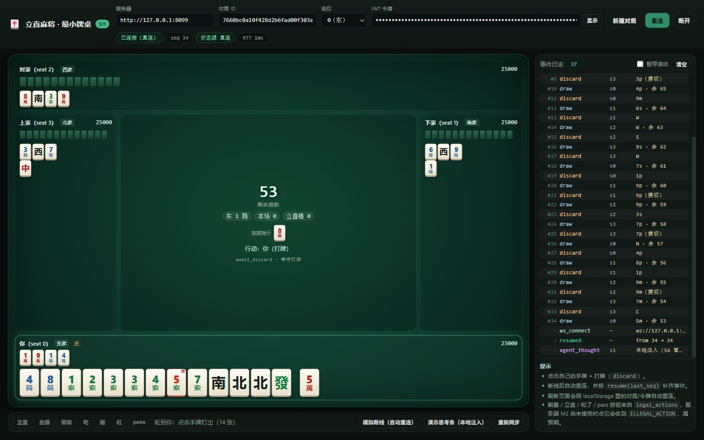

# S11 最小牌桌前端（`web/`）

纯静态网页牌桌：**无框架、无构建步骤、无 npm 依赖**，三个文件（`index.html` / `app.js` / `style.css`）
打开浏览器就能连上 `riichi-server` 的 WebSocket 打一局。



> 截图：东 1 局、自己手牌 14 张（含赤 5 索）、四家牌河、宝牌指示、剩余牌数、事件日志、
> 思考条（本地演示注入）。

---

## 1. 它是什么 / 不是什么

**是**：一个用来「真人验收 S6 服务层」的最小客户端。

- WebSocket 事件流渲染：摸牌 / 打牌 / 副露 / 立直 / 宝牌 / 和了 / 流局 / 局结束 / 思考条
- 自己的手牌可点击打出（`discard`），合法动作按钮由 `legal_actions` 生成
- 断线**自动重连**并按 `resume(last_seq)` 补齐；刷新页面用 `localStorage` 自动续上
- 四家牌河 / 副露 / 立直标记 / 宝牌指示 / 点数 / 场风·局数·本场·立直棒 / 剩余牌数

**不是**：不是正式产品前端，没有登录、没有动画、没有音效、没有移动端专门适配；
副露的选择式交互（从多种「吃」里挑一种、手牌选 2-3 张）留到 M2 服务端接口稳定之后再做，
目前如果服务端 `legal_actions` 里出现具体动作，点按钮就直接按该动作提交。

### 文件

| 文件 | 作用 |
|---|---|
| `index.html` | 页面结构：连接栏 / 牌桌 / 动作区 / 事件日志 |
| `app.js` | 全部逻辑：WS 连接、resume、事件→状态、渲染、动作提交、断线重连 |
| `style.css` | 深色牌桌样式（纯 CSS 变量，无预处理器） |
| `serve.py` | **兜底**：静态页 + `/api` 同源反代（只在后端没开 CORS 时需要；Python 标准库，零依赖） |
| `README.md` | 本文件：怎么起、怎么验收、已知限制 |

---

## 2. 快速开始（3 步）

### 2.1 起服务

```bash
cd riichi
go run ./cmd/riichi-server -addr 127.0.0.1:8099 -jwt-secret dev -cors "*"
```

- `-cors "*"` 是**默认值**（demo 用），作用是让浏览器从 `file://` 或别的端口也能读 HTTP 状态接口；
  生产必须收窄成具体域名（例如 `-cors "https://mahjong.example.com"`），或者干脆关掉 CORS
  改走同源反代（见 §2.3 的 `serve.py`）。
- 端口 8099 被占用时换一个，页面上的「服务器」输入框跟着改。

### 2.2 拿令牌（每个座位一个）

```bash
# 座位 0（人类，默认 agents = human,random,random,random）
go run ./cmd/riichi-server -jwt-secret dev -issue-token 0

# 座位 1/2/3（这三个座位默认是 AI，连上去只能观战，不能替它打）
go run ./cmd/riichi-server -jwt-secret dev -issue-token 1
```

令牌默认 2 小时过期（`-token-ttl` 可调）。**`-jwt-secret` 必须和起服务时用的一致**。
把打印出来的长串填进页面的「JWT 令牌」输入框。

### 2.3 打开页面

**方式 A（首选）：直接双击 `web/index.html`（`file://`）**

浏览器地址栏是 `file:///.../web/index.html` 也能用 —— 因为 WS 不受同源限制，而 HTTP 状态接口
由服务端 `-cors "*"` 放行。页面里的「服务器」填 `http://127.0.0.1:8099`（或 `ws://127.0.0.1:8099`，
两种写法都行，脚本会自动把 `http→ws`）。

**方式 B（兜底）：用 `serve.py` 起同源反代**

适用场景：后端没开 CORS（`-cors ""` 关闭）、或部署在只允许同源的网关后面。

```bash
python web/serve.py --port 8098 --target http://127.0.0.1:8099
# 然后浏览器打开 http://127.0.0.1:8098/
```

页面会先尝试「直连」、失败再自动退回「同源反代」，右上角「状态源」会显示当前用的是哪种。
（直连失败时浏览器控制台会留一条 CORS 报错，属预期。）

**方式 C**：任何静态服务器（`python -m http.server`、nginx）都行，只要后端开了 CORS。

### 2.4 建一局

**页面建局（推荐）**：填好令牌 → 点「新建对局」→ 自动建局并连接。
默认 `agents = ["human","random","random","random"]`，你是座位 0（东家），其余三家 AI 自动打。

**curl 建局**（想自己指定 seed / 座位）：

```bash
TOKEN=<座位 0 的令牌>
curl -s -X POST http://127.0.0.1:8099/api/v1/games \
  -H "Authorization: Bearer $TOKEN" -H "Content-Type: application/json" \
  -d '{"seed": 42, "agents": ["human", "random", "random", "random"]}'
# → {"game_id":"...","seed":42,"seq":2,"agents":[...],...}
```

把 `game_id` 填进页面的「对局 ID」，点「连接」。

---

## 3. 协议速查（只看前端用到的那几条）

完整定义见 `docs/riichi-接口契约-20261110.md` §6。

```text
WS  /api/v1/ws/games/{game_id}?seat=0&token=<JWT>
    连接后**不会**自动回放历史，必须发 resume：

客户端 → 服务端
  {"type":"resume","last_seq":0}                              # 0 = 要全量
  {"type":"action","seq":42,"action_id":"<uuid>","action":{"kind":"discard","tile":"2m"}}
  {"type":"ping","ts":1730000000000}

服务端 → 客户端
  {"type":"event","seq":42,"kind":"discard","seat":0,"payload":{"tile":"2m","tsumogiri":false}}
  {"type":"resumed","from_seq":42,"to_seq":50}
  {"type":"pong","ts":1730000000000}
  {"type":"error","code":"ILLEGAL_ACTION","message":"..."}
```

- `action_id` 幂等：同一 id 重复提交只执行一次；`seq` 与服务端不一致回 `STALE_SEQ`。
- 事件全集：`round_start / draw / discard / chi / pon / kan / riichi / dora_reveal /
  tsumo / ron / ryuukyoku / round_end / game_end / agent_thought / error`。
- 前端还用了两个 HTTP 接口（`Authorization: Bearer <token>`）：
  - `GET /api/v1/games/{id}` —— 权威状态（自己的手牌、宝牌指示、`legal_actions`、phase/turn）。
    **WS 协议里没有状态快照消息，初始手牌只能从这里拿**，所以 CORS 必须放行。
  - `GET /api/v1/games/{id}/replay` —— 全量事件，页面首次连接时用来把历史写进日志、
    并从 `round_start` 里取庄家（状态接口没返回 dealer）。

---

## 4. 页面怎么用

| 区域 | 说明 |
|---|---|
| 顶部连接栏 | 服务器地址 / 对局 ID / 座位 / JWT / 新建·连接·断开；右侧四个胶囊：连接状态、`seq`、状态源、RTT |
| 牌桌 | 上=对家、左=上家、右=下家、下=自己；每家显示 自风 / 庄 / 点数 / 立直 / 副露 / 手牌（对手是牌背）/ 牌河 |
| 中央 | 剩余牌数、场风·局数·本场·立直棒、宝牌指示、当前行动者与 phase |
| 手牌 | **点一下就打出**（`discard`）；最后一张是刚摸的牌（与手牌隔开） |
| 动作区 | 来自 `legal_actions` 的按钮（摸牌 / 立直 / 自摸 / 荣和 / 吃 / 碰 / 杠 / pass）；当前不在合法集合里的显示为灰色占位 |
| 思考条 | 收到 `agent_thought` 时显示「agent · 耗时 → 选择 · 候选」；S6 目前还没发这个事件，可用「演示思考条（本地注入）」验收 UI |
| 事件日志 | 实时事件 + `resume` 补齐的历史事件；每条带 `seq / kind / seat / 摘要` |

调试把手（浏览器 DevTools）：

```js
__s11.state              // 当前前端状态对象（只读看）
__s11.simulateDrop()     // 模拟断线：关掉 WS，触发自动重连 + resume（等价于点「模拟断线」按钮）
__s11.reconnectNow()     // 立刻走一次「重连」路径
__s11.resumeFrom(0)      // 手动发一次 resume(0)，回放全量事件
```

---

## 5. 手动验收步骤（逐条 + 预期结果）

> 前置：`go build ./...` 能过、8099 没被占用。下面命令在 Windows PowerShell / git-bash 里都可跑，
> `$TOKEN` 换成实际令牌。**每一步的「预期」都验证过**（见 §9 记录）。

### 步骤 1：起服务

```bash
cd riichi
go run ./cmd/riichi-server -addr 127.0.0.1:8099 -jwt-secret dev -cors "*"
```

预期日志：`riichi-server 启动 addr=127.0.0.1:8099 agent_timeout=500ms cors=*`。
另开一个终端：`curl -s http://127.0.0.1:8099/healthz` → `{"status":"ok"}`。

### 步骤 2：签令牌

```bash
go run ./cmd/riichi-server -jwt-secret dev -issue-token 0
```

预期：打印一行 JWT（`eyJ...`，三段点分），进程立刻退出。

### 步骤 3：打开页面并连接

1. 浏览器打开 `web/index.html`（`file://` 即可）。
2. 「服务器」= `http://127.0.0.1:8099`；「座位」= `0`；「JWT 令牌」= 步骤 2 的令牌。
3. 点「新建对局」。

预期：
- 连接状态变 **已连接（直连）**，`状态源 直连`，`seq 2`；
- 日志出现 `create` → `round_start` → `draw` → `ws_connect ... resume(2)` → `resumed from 2 → 2`；
- 中央：`东 1 局 / 本场 0 / 立直棒 0`、剩余牌数 `69`、宝牌指示 1 张；
- 自己手牌 **14 张**（最后一张是刚摸的，与手牌隔开），其余三家各 13 张牌背；
- 动作提示：「轮到你：点击手牌打出（14 张）」。

### 步骤 4：打一张牌（核心闭环）

1. 点自己任意一张手牌。

预期：
- 日志新增 `action {"kind":"discard","tile":"..."}` → `discard ...`；
- 手牌从 14 变 13，该牌进入自己牌河并高亮；
- 随后 3 家 AI 依次 `draw` / `discard`（日志连续出现，牌河各 +1）；
- 轮回到自己时手牌又变 14 张，提示恢复「轮到你」。

**连续点 4 次**，四家牌河各 4 张、剩余牌数从 69 递减到 53，`seq` 单调增长。

### 步骤 5：断线自动重连 + `resume(last_seq)` 补齐

1. 点动作区右侧「模拟断线（自动重连）」。

预期：
- 状态变 `断开，1s 后重连…`，日志出现 `ws_close 模拟断线...` 与 `reconnect WS 关闭 code=1005，1200ms 后重连（第 1 次）`；
- 约 1.2s 后自动变成 **已连接（直连）**，日志出现
  `ws_connect ... resume(<断线前的 seq>)` 与 `resumed from X → Y`；
- **补齐验证（要看到真实补发）**：开第二个标签页打开同一页面（`localStorage` 会带上同一局与令牌，
  自动连上，两个客户端同座位是允许的）。第一个标签页点「模拟断线」，**趁 1.2s 窗口内在第二个标签页
  打一张牌**（AI 会跟着走几手），然后回到第一个标签页等它自动重连。
  预期日志按序出现 `ws_connect ... resume(N)`、`#N+1 draw ...`、`#N+2 discard ...` …… `resumed from N+1 → M`，
  手牌与第二个标签页完全一致 —— 这就是「不丢不重」。
- 也可以点「断开」再点「连接」：手动连接会先拉权威状态再 `resume(当前 seq)`（同样正确，只是不走补发）。

### 步骤 6：刷新后自动续上

1. 按 F5 刷新页面。

预期：无需再输入任何东西 —— 页面从 `localStorage` 恢复对局与令牌，自动连接，
手牌/牌河/点数/日志（历史事件）全部还原，状态栏 `seq` 与刷新前一致。

### 步骤 7：思考条

1. 点「演示思考条（本地注入）」。

预期：牌桌与动作区之间出现一条黄色虚线状态带：`[本地演示] <agent> · seat N  思考 xxms → 打 X · 候选 5：…`，
12 秒后自动消失，日志出现一条 `agent_thought`（标注「本地注入」）。

> 说明：S6 目前**不产生** `agent_thought` 事件；等 S6 接上 AI 决策事件后，这里会自动显示真实数据。

### 步骤 8：新建对局 / 换座位（可选）

1. 再点一次「新建对局」→ 预期旧的 `game_id` 被替换、事件日志清空、回到 `seq 2` 的新牌局。
2. 用 `-issue-token 1` 的令牌 + 座位 `1` 重新连接 → 预期能连上、能看牌桌（座位 1 是 AI，
   点手牌会收到 `ILLEGAL_ACTION`，属预期）。

### 步骤 9：兜底路径（后端关闭 CORS 时）

```bash
# 终端 A：后端关掉 CORS
go run ./cmd/riichi-server -addr 127.0.0.1:8096 -jwt-secret dev -cors ""

# 终端 B：同源反代
python web/serve.py --port 8095 --target http://127.0.0.1:8096
```

浏览器打开 `http://127.0.0.1:8095/`，服务器填 `http://127.0.0.1:8096`，用 `-issue-token 0` 的令牌 +
一个在 8096 上建的 `game_id` 连接。

预期：状态栏显示 **已连接（同源代理）**、`状态源 同源代理`；手牌可见、可打牌。
浏览器控制台会出现一条 `blocked by CORS policy` 报错（直连尝试失败后自动退到反代），属预期。

---

## 6. 故障排查

| 现象 | 原因 / 处理 |
|---|---|
| 状态栏「未连接」，横幅提示拿不到状态 | 后端没起 / 地址错 / 后端关了 CORS 且页面不是同源。先 `curl http://127.0.0.1:8099/healthz`；若是 CORS，用 `-cors "*"` 或 `serve.py` |
| 连接后立刻断开、反复重连 | 令牌过期（2h）或座位与令牌不一致。用 `-issue-token 0` 重签；或用 `?` 看横幅：`SEAT_MISMATCH` 会明确提示 |
| 页面显示 `仅事件流模式` | HTTP 状态拿不到（纯 WS 模式）：牌河/剩余牌数/点数可见，但**没有手牌、不能打牌**。按上一条修好 CORS |
| 点牌没反应 | 不是你的回合（提示显示「等待 seat N 行动」），或动作已提交等待事件（提示「已提交…」） |
| 打牌后收到 `ILLEGAL_ACTION` | 该座位由 AI 控制（座位 1-3），或服务端 M2 未实现该动作；页面会自动重新同步 |
| `STALE_SEQ` | 客户端 seq 落后（另一个客户端刚操作过）。页面会自动拉一次权威状态，再点一次即可 |
| 端口占用 | 换 `-addr 127.0.0.1:8100`，页面的「服务器」跟着改 |
| `go build` 偶发失败 | 仓库有并行 WIP（rules/eval/mcp），与本前端无关；`git stash` 或等对应分支合入 |

---

## 7. 已知限制 / 与 S6·S5 的边界

1. **`agent_thought` 还没有真实来源**：S6 目前只发 `event/resumed/pong/error`，AI 决策事件
   （agent 名、耗时、候选）还没接进 transport。前端已实现渲染，等 S6 发事件即生效；
   在那之前用「演示思考条（本地注入）」验收 UI。
2. **副露/立直/和了的交互只做「按合法动作原样提交」**：`legal_actions` 里给出具体
   `{kind, tile, consumed}` 时，点按钮会把该动作原样发出；但「吃」有多种选择、手牌选 2-3 张
   这类**选择式 UI** 留到 M2（服务端响应窗口稳定后）。当前 M1（摸打）路径是完整可玩的。
3. **对手手牌张数是估算**：HTTP 状态接口按座位裁剪，只给自己手牌；对手牌背数量按
   `13 - 3*副露数 (+1 如果正在等他打牌)` 推算，仅用于视觉。
4. **`localStorage` 里存了令牌**：纯前端 demo 的便利做法，生产应改成 cookie/内存 + 后端会话；
   令牌 2h 过期，页面会提示重连失败。
5. **`-cors "*"` 只适合 demo**：任意站点都能带着用户令牌调接口；生产必须收窄白名单、
   或改成同源反代（`serve.py` 或 nginx）。
6. **无自动化测试**（任务约定）：本目录靠 §5 的手动验收；服务端协议行为由 `riichi/internal/transport`
   的 Go 单测保证。
7. 事件按全量广播（含别人的摸牌），没有按座位过滤 —— 这是 S6 的 M1 已知项，前端照单渲染。

---

## 8. 实现说明（为什么这么做）

- **状态双源：HTTP 快照 + WS 事件流**。WS 协议没有快照消息，初始手牌只能走
  `GET /api/v1/games/{id}`；之后用手牌可增量维护（`draw` 加牌、`discard` 减牌）。
  遇到不确定的事件（副露/和了等 payload 还在演进）就 `scheduleSync()` 拉一次权威状态兜底，
  宁可多一次 HTTP，也不猜错状态。
- **事件按 `seq` 去重**：`resume` 会重放事件，`lastEventSeq` 是水位线，`seq <= 水位` 只写日志、
  不重复改状态；`resumed` 消息不进水位线（它不是对局事件）。
- **重连策略**：`onclose`（非用户主动断开）→ 指数退避 1.2s/2.2s/3.9s… 最多 8 次；
  自动重连走 `resume(lastEventSeq)`（逐条补发）；手动「连接」先拉快照再 `resume(快照 seq)`。
- **`action_id` 用 `crypto.randomUUID()`**：配合服务端幂等表，双击/重发不会打两张牌。
- **失败可见**：所有服务端 `error` 都会出现在横幅 + 事件日志，`STALE_SEQ` 自动重同步。

---

## 9. 本次验收记录（实际跑过的证据）

环境：Windows + Go 1.25.6 + `riichi-server`（含 S6 + CORS 提交 `663a4d3`）+ Chromium（Playwright 驱动）。

| 验收点 | 结果 |
|---|---|
| `file://` 同源语义下的 CORS | `OPTIONS` 带 `Origin: null` → `204` + `Access-Control-Allow-Origin: *` + `Allow-Headers: Authorization, Content-Type`；`GET /api/v1/games/{id}` → `200` |
| 页面加载（http 源，跨源直连） | 已连接（直连）、`seq 2`、手牌 14 张、宝牌 1 张、四家 25000 点 |
| 打牌闭环 | 连续 4 次点牌：`seq 10 → 34`，四家牌河各 4 张，剩余牌数 69 → 53，手牌始终 13/14 张 |
| 断线自动重连 + 补齐 | 点「模拟断线」→ 日志 `reconnect 1200ms 后重连` → `ws_connect ... resume(18)` → 补发 `#19…#26` → `resumed`，手牌与另一标签页一致 |
| 刷新续上 | F5 后自动连接、`seq` 一致、历史事件全部还原 |
| 新建对局 | 新 `game_id`、日志清空、回到 `seq 2` 新牌局 |
| 思考条 | 本地注入显示 `[本地演示] shanten · seat 1 思考 8ms → 打 9s · 候选 5` |
| 同源反代兜底（后端 `-cors ""`） | 状态栏 `已连接（同源代理）`、`状态源 同源代理`，手牌可见、discard 成功（`seq 2 → 10`） |
| `serve.py` 反代 | 静态 `200`、`/api/...` 带 Bearer `200`、`/healthz` `200`、404 透传 |


